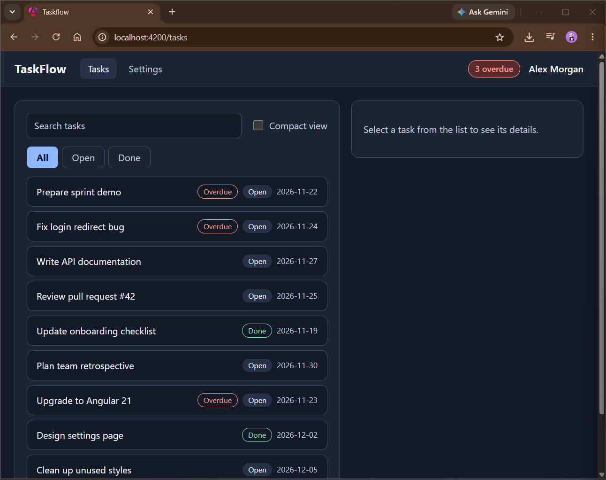
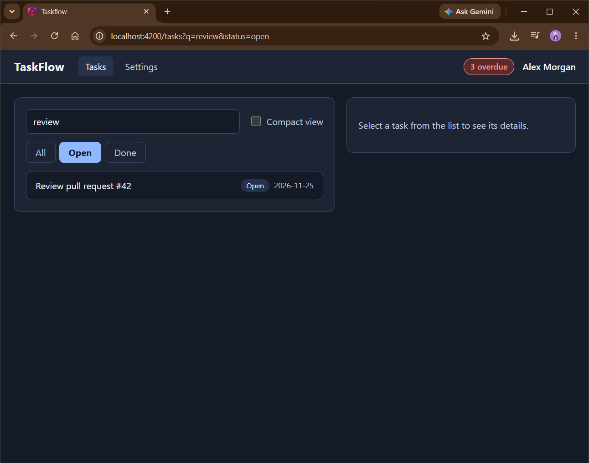
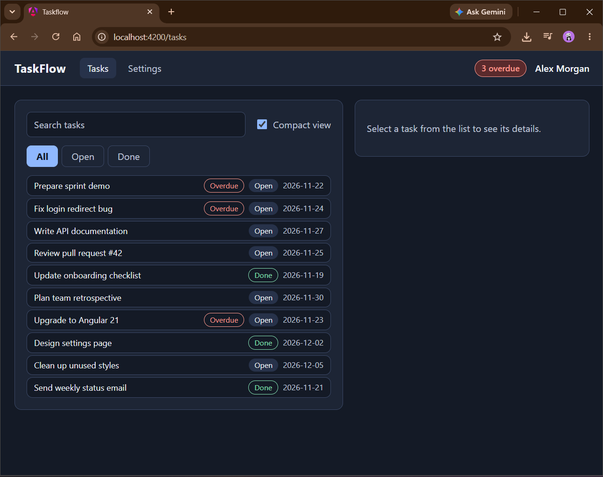
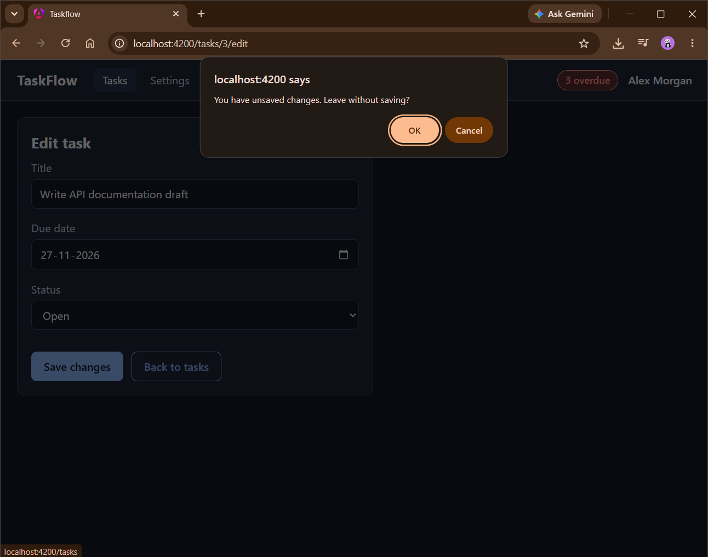

# TaskFlow

TaskFlow is a small task management application built with **Angular 21** for the State Management assessment. It is organised around one central question: **who owns this data?**

All state is handled with signals, signal services, the URL and reactive forms. NgRx and RxJS Subjects are not used.

## Contents

1. [A. Running the application](#a-running-the-application)
2. [Requirements and implementation](#requirements-and-implementation)
3. [State planning](#state-planning)
4. [B. State table](#b-state-table)
5. [Signal service pattern](#signal-service-pattern)
6. [Rules and principles](#rules-and-principles)
7. [Review checklist](#review-checklist)
8. [C. Problems in the review code](#c-problems-in-the-review-code)
9. [Design and styling](#design-and-styling)
10. [Screenshots](#screenshots)
11. [Project structure](#project-structure)

---

## A. Running the application

**Requirements:** Node.js 20.19 or later.

```bash
npm install
ng serve        # or: npm start
```

The application is served at http://localhost:4200.

> There is no backend. `TaskService` generates the mock tasks in memory, so a page refresh reloads the original data. Search text and the status tab persist across a refresh because they are stored in the URL.

---

## Requirements and implementation

`TaskService` returns 10 mock tasks after an 800 ms delay, as if they came from an API. Due dates are generated relative to the current date, so overdue tasks are always present.

| # | Requirement | Implementation |
|---|-------------|----------------|
| 1 | Top bar on every page, showing the user name and "X overdue" | `layout/top-bar.ts` is placed in the root `App` template above `<router-outlet>`, so it appears on every route. It reads `TaskService.overdueCount()` and `UserService.name()` directly. `App` calls `load()` on start, so the count is correct on any page. |
| 2 | Tasks page shows the list, with a loading message | `TaskService` exposes a read-only `loading` signal. `TaskList` shows "Loading tasks…" while it is `true`. |
| 3 | Search box filters the list; the text persists after a refresh | The search text is stored in the URL as `?q=`. `TasksPage` receives it as a route input (`withComponentInputBinding()`), and the list emits changes upward. The parent updates the URL with `router.navigate` (`queryParamsHandling: 'merge'`, `replaceUrl: true`). A refresh restores the text. |
| 4 | Status tabs: All, Open, Done | Same pattern as search, using `?status=open` or `?status=done`. Unrecognised values fall back to `all`. The filtered list is a `computed()` named `visible` in `TaskList`. |
| 5 | Compact-view toggle shows smaller rows | A `compact` signal inside `TaskList`. Only the list uses it, so it stays in the component. It applies a CSS class that reduces row size. |
| 6 | Clicking a task highlights it and shows its details | `TasksPage` owns the `selectedId` signal because the list and the details panel are siblings. It is passed down with `input()` and updated through `output()`. `selected` is a `computed()` that looks up the task in the service. |
| 7 | "Mark as done" button; the overdue count updates immediately | The button calls `TaskService.markDone(id)`, which updates the private task signal. `overdueCount` is a `computed()` over the same signal, so the top bar recalculates without any synchronisation. |
| 8 | Edit task form (title, due date, status); warning on unsaved changes | `tasks/edit-task.ts` uses a reactive `FormGroup` with validators. A functional `canDeactivate` guard reads `form.dirty` and asks for confirmation before leaving. After saving, the form is marked pristine, so no warning appears. The task id comes from the URL (`/tasks/:id/edit`). |
| 9 | Settings page shows the same user name as the top bar | `settings/settings-page.ts` reads `UserService.name()`, the same signal as the top bar: one owner, two readers. |

---

## State planning

The state was planned before any code was written, using a plan-first approach: describe the feature, decide the kind, owner and level of each piece of data, then implement.

### Kinds of state

| Kind | Meaning | Used in TaskFlow |
|------|---------|------------------|
| Local UI | Interface state of a component | Compact view, selected task |
| URL | Survives a refresh, shareable as a link | Search text, status tab, task `:id` |
| Server | A copy of backend data; needs loading handling and caching | Task list |
| Form | Owned by the `FormGroup` (values, dirty, valid) | Edit form, unsaved changes |
| Shared | Used by distant components | User name |
| Derived | Calculated from other state | Overdue count, filtered list, selected task |

### Levels: where state lives

| Level | Location | Used when |
|-------|----------|-----------|
| 1 | Component signal | Only that component needs it |
| 2 | Parent, via `input()` and `output()` | Sibling components need it |
| 3 | Signal service | Distant components need it |

A kind is not a level. The selected task is Local UI state, but it lives at Level 2 because two siblings need it. URL, Server and Form state are already owned elsewhere, so no level has to be chosen for them.

### The four questions applied to each piece of data

| Data | 1. Who needs it? | 2. Survive refresh or be shared? | 3. Copy of backend data? | 4. Can it be calculated? | Decision |
|------|------------------|----------------------------------|--------------------------|--------------------------|----------|
| Search text | List (and page) | Yes | No | No | URL |
| Status tab | List (and page) | Yes | No | No | URL |
| Compact view | Only the list | No | No | No | Level 1 |
| Task list | Top bar, list, details, edit page | No | Yes | No | Root service (server state) |
| Selected task | List and details (siblings) | No | No | The task itself is looked up | Level 2 (`selectedId`) plus `computed()` |
| Unsaved changes | Edit form, route guard | No | No | Already tracked by the form | `FormGroup` (`dirty`) |
| Overdue count | Top bar | No | No | Yes, from the task list | `computed()` in the service |
| User name | Top bar and Settings | No | No | No | Root service (shared) |

The question "must it survive leaving the screen?" is answered with root services: the task list and user name stay available across pages.

---

## B. State table

| # | Data | Kind | Where it lives | Why |
|---|------|------|----------------|-----|
| 1 | Search text | URL | `?q=` query parameter, bound into `TasksPage` through a route input | It must survive a refresh, so the URL owns it and the list only reads it. |
| 2 | Selected status tab | URL | `?status=` query parameter, bound into `TasksPage` | It is a shareable view of the list, so it follows the same rule as search. |
| 3 | Compact view on/off | Local UI | `compact` signal inside `TaskList` (Level 1) | Only the list uses it, so it stays in the component. |
| 4 | Task list from the API | Server | `TaskService` (root), private `_tasks` signal exposed with `asReadonly()` | It is a copy of backend data used by the top bar, list, details and edit page; the service also holds `loading` and caches the first load. |
| 5 | Selected task | Local UI | `selectedId` signal in `TasksPage` (Level 2); the task itself is a `computed()` | The list highlights it and the details panel shows it, so the shared parent owns it and passes it down with `input()` and `output()`. |
| 6 | Edit form has unsaved changes | Form | `form.dirty` on the `FormGroup` in `EditTask`, read by the `canDeactivate` guard | The `FormGroup` already tracks dirty, so no extra signal is kept. |
| 7 | Overdue task count | Derived | `computed()` in `TaskService` | It is calculated from the task list and never stored, so it updates the moment a task changes. |
| 8 | User's name | Shared | `UserService` (root), private signal exposed with `asReadonly()` | The top bar and Settings are distant components that must show the same value. |

---

## Signal service pattern

Both services follow the same signal service pattern: a private writable signal, a read-only public view, computed values, and methods as the only way to change state ("one owner, many readers").

```ts
@Injectable({ providedIn: 'root' })
export class TaskService {
  // 1. Private and writable
  private readonly _tasks = signal<Task[]>([]);
  private readonly _loading = signal(true);

  // 2. Public and read-only
  readonly tasks = this._tasks.asReadonly();
  readonly loading = this._loading.asReadonly();

  // 3. Derived, never stored
  readonly overdueCount = computed(() => this._tasks().filter(isOverdue).length);

  // 4. Methods: the only way to change state
  markDone(id: number) { this.update(id, { status: 'done' }); }
  update(id: number, patch: Partial<Omit<Task, 'id'>>) {
    this._tasks.update(list => list.map(t => (t.id === id ? { ...t, ...patch } : t)));
  }
}
```

---

## Rules and principles

### Assessment rules

| Rule | Implementation |
|------|----------------|
| Use signals; no NgRx; no RxJS Subjects for state | Only `signal`, `computed`, `input` and `output` are used for state. There are no Subjects and no NgRx imports. |
| Writable signals are private and exposed with `asReadonly()` | `TaskService` keeps `_tasks` and `_loading` private, and `UserService` keeps `_name` private. Public members use `.asReadonly()`. |
| Only the service's methods can change its state | State changes only through `markDone()`, `update()` and the internal `fetch()`. Components never call `.set()` on service state. |
| Calculated values use `computed()`; never stored separately | `overdueCount` (service), `visible` (list), `selected` (parent page) and `task` (edit page). |
| No `effect()` that copies one signal into another | The project contains no `effect()`. |
| Reactive forms for the edit form; no extra form-state signals | The edit form is a `FormGroup`. Dirty and valid state are read from the form itself. |

### Design principles

| Principle | Application in TaskFlow |
|-----------|-------------------------|
| **Single source of truth**: each piece of data lives in exactly one place | The task list exists only in `TaskService`; the user name only in `UserService`. No component keeps its own copy. |
| **Derive, don't duplicate**: if it can be calculated, use `computed()` | The overdue count, the filtered list and the selected task are all calculated, never stored. |
| **One-way data flow**: data goes down, events go up; only the owner changes it | `TasksPage` passes data down with `input()`; the list reports clicks and typing up with `output()`; only services and the owning parent change state. |

---

## Review checklist

A review checklist was applied to the final code to confirm that common state management mistakes are absent.

| Checklist item | Result |
|----------------|--------|
| The same data stored in two places | None. Each piece of data has one owner (see the state table). |
| A stored value that should be `computed()` | None. All calculated values use `computed()`. |
| `effect()` copying one signal into another | None. The project has no `effect()`. |
| Form or URL state re-tracked in signals | None. Form state is read from the `FormGroup`; search text and status are read from the URL. |
| Writable signals exposed publicly | None. All writable signals are private. |
| One service holding unrelated state | None. `TaskService` holds task data only; `UserService` holds user data only. |
| NgRx or RxJS Subjects sneaking in | None. |

---

## C. Problems in the review code

The review code from section 2 of the assessment contains the following state management problems.

### 1. A derived value is stored as a separate signal

```ts
tasks = signal<Task[]>([]);
overdueCount = signal(0);          // stored copy
// ...inside load():
this.overdueCount.set(tasks.filter(t => t.isOverdue).length);
```

`overdueCount` can be calculated from `tasks`, but it is stored and set by hand. Whenever a task changes (for example, "Mark as done"), the count can disagree with the list. This is the classic "badge shows 3, list holds 2" inconsistency. It breaks "single source of truth" and "derive, don't duplicate".

**In TaskFlow:** `overdueCount` is a `computed()` over the private task signal, so it cannot drift.

### 2. Writable signals are public

`tasks` and `overdueCount` are public and writable, so any component can call `.set()` on them. When a value is wrong, the cause could be anywhere in the app.

**In TaskFlow:** writable signals are private, public access is through `asReadonly()`, and state changes only through service methods such as `markDone()` and `update()`.

### 3. `effect()` copies one signal into another

```ts
countSig = signal(0);
constructor() {
  effect(() => this.countSig.set(this.taskService.overdueCount()));
}
```

`TopBarComponent` copies the service's count into its own `countSig`. This creates a second copy of the same data, adds an unnecessary update step, and is the pattern the assessment prohibits.

**In TaskFlow:** the top bar reads `tasks.overdueCount()` directly in its template and keeps no local copy.

### 4. Server state has no loading handling or caching

`load()` has no loading flag, nothing prevents it from fetching again on every call, and it relies on a server-supplied `isOverdue` flag that becomes inaccurate as time passes. The `subscribe` call is also not tied to any lifecycle.

**In TaskFlow:** `TaskService` exposes a `loading` signal, loads once and reuses the result, and calculates overdue status from the due date and task status.

---

## Design and styling

The interface uses a dark navy theme with light text for strong contrast and a soft blue accent. Overdue items use a coral outline and completed items a green outline, so status is not conveyed by colour alone. Keyboard focus is clearly visible, and the layout collapses to one column on small screens.

Styling is written in **SCSS** (`src/styles.scss`) using variables for the colour tokens, nesting, and a mixin for the status tags.

---

## Screenshots

**Tasks page while loading**


*Figure 1. A loading message is shown while `TaskService` simulates the API delay (requirement 2).*

**Task list with the overdue count in the top bar**



*Figure 2. The top bar shows the user name and the overdue count on every page; overdue tasks are tagged in the list (requirements 1 and 2).*

**Search text and status tab stored in the URL (`?q=...&status=...`)**



*Figure 3. Search text and the status tab are stored in the URL, so they remain after a refresh (requirements 3 and 4).*

**Selected task highlighted, with the details panel**


*Figure 4. The selected task is highlighted in the list and its details appear in the panel (requirement 6).*

**After "Mark as done": the overdue count has decreased**


*Figure 5. "Mark as done" updates the overdue count in the top bar immediately, because the count is a `computed()` value (requirement 7).*

**Compact view**



*Figure 6. Compact view reduces row size; this state is local to the task list (requirement 5).*

**Edit task page with the unsaved-changes warning**



*Figure 7. Leaving the Edit task page with unsaved changes triggers a confirmation, based on the form's `dirty` state (requirement 8).*

**Settings page showing the same user name as the top bar**


*Figure 8. The Settings page reads the same `UserService` signal as the top bar, so the name matches (requirement 9).*

---

## Project structure

```
src/
  styles.scss
  app/
    core/       task.model.ts, task.service.ts, user.service.ts
    layout/     top-bar.ts
    tasks/      tasks-page.ts (parent), task-list.ts, task-details.ts, edit-task.ts
    settings/   settings-page.ts
    app.ts, app.routes.ts, app.config.ts
docs/screenshots/   images used in this README
```
