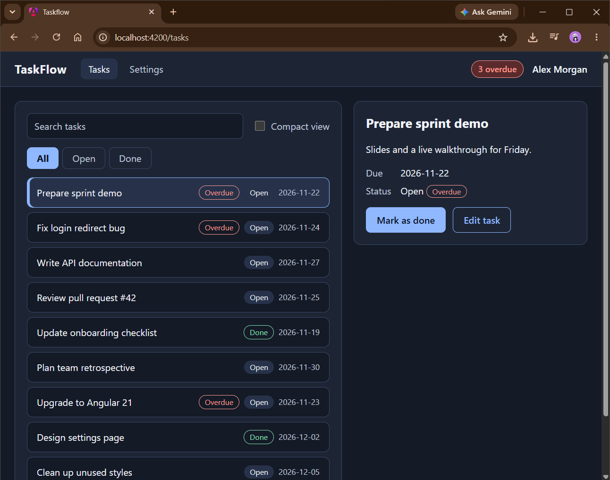
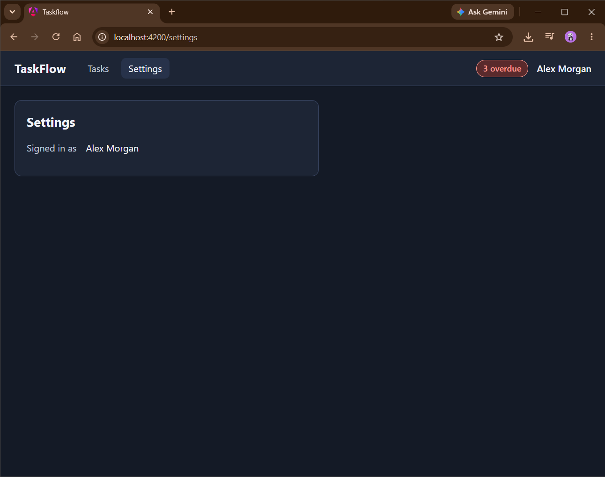

# TaskFlow

TaskFlow is a small task management application built with **Angular 21** as part of the State Management assessment. The project is organised around a single question: **who owns each piece of data?** State is managed with signals, signal services, the URL and reactive forms. NgRx and RxJS Subjects are not used.

## Contents

1. [Running the application](#a-running-the-application)
2. [Approach](#approach)
3. [Feature implementation](#feature-implementation)
4. [Rule compliance](#rule-compliance)
5. [Design](#design)
6. [Use of AI tools](#use-of-ai-tools)
7. [Screenshots](#screenshots)
8. [State table](#b-state-table)
9. [Review of the sample code](#c-problems-in-the-review-code)
10. [Project structure](#project-structure)

---

## A. Running the application

**Requirements:** Node.js 20.19 or later.

```bash
npm install
ng serve        # or: npm start
```

The application is served at http://localhost:4200.

---

## Approach

### State planning

The state was planned before any code was written. Each piece of data was evaluated against four questions:

1. **Who needs it?** A single component (Level 1), sibling components through a parent (Level 2), or distant components through a service (Level 3).
2. **Should it survive a refresh or be shareable?** If so, it belongs in the URL.
3. **Is it a copy of backend data?** If so, it is server state, with loading handled and the result cached.
4. **Can it be calculated from other state?** If so, it is exposed with `computed()` and never stored.

The outcome of this plan is recorded in the [state table](#b-state-table).

### Project setup

- Generated with the Angular CLI (Angular 21, standalone components, routing, CSS).
- `withComponentInputBinding()` is enabled in `app.config.ts`, so route parameters and query parameters are delivered to components as `input()` values.
- Source is grouped by responsibility: `core/` (model and services), `layout/` (top bar), `tasks/` (list, details, edit and the parent page) and `settings/`.

---

## Feature implementation

| # | Requirement | Implementation |
|---|-------------|----------------|
| 0 | Mock `TaskService` with about 10 tasks and a short delay | `core/task.service.ts` provides 10 seed tasks. An internal `fetch()` waits 800 ms before setting the data, simulating an API call. `load()` returns the same promise on repeated calls, so tasks are fetched once and cached. Due dates are generated relative to the current date, so overdue tasks are always present. |
| 1 | Top bar on every page showing the user name and "X overdue" | `layout/top-bar.ts` is placed in the root `App` template above `<router-outlet>`, so it appears on every route. It reads `TaskService.overdueCount()` and `UserService.name()` directly. `App` triggers `load()` on start so the count is correct on any page. |
| 2 | Loading message on the Tasks page | `TaskService` exposes a read-only `loading` signal. `TaskList` displays "Loading tasks…" while it is `true`. |
| 3 | Search that persists after refresh | The search text is stored in the URL as `?q=`. `TasksPage` receives it as a route input and passes it to the list. The list emits `qChange`, and the parent updates the URL with `router.navigate` (`queryParamsHandling: 'merge'`, `replaceUrl: true`). Because the URL is the owner, a refresh restores the value. |
| 4 | Status tabs: All, Open, Done | Implemented in the same way as search, using `?status=open` and `?status=done`. Unrecognised values fall back to `all`. |
| 5 | Compact-view toggle | A `compact` signal inside `TaskList` (Level 1). Only the list requires it, so it is not lifted. It applies a CSS class that reduces row size. |
| 6 | Click a task to highlight it and show its details | `TasksPage` owns the `selectedId` signal, since the list and the details panel are siblings (Level 2). It is passed down with `input()` and updated through `output()`. `selected` is a `computed()` that looks up the task in the service, so the panel always shows current data. |
| 7 | "Mark as done" updates the top bar immediately | The button calls `TaskService.markDone(id)`, which updates the private signal. `overdueCount` is a `computed()` over the same signal, so the top bar recalculates automatically. No value is copied or synchronised. |
| 8 | Edit form with unsaved-changes warning | `tasks/edit-task.ts` uses a reactive `FormGroup` (title, due date, status) with validators. A functional `canDeactivate` guard reads `form.dirty` and asks for confirmation before leaving. After a successful save the form is marked pristine, so no warning is shown. The task id comes from the URL (`:id`). |
| 9 | Settings page shows the same user name | `settings/settings-page.ts` reads `UserService.name()`, the same signal used by the top bar: one owner, two readers. |

---

## Rule compliance

| Rule | Implementation |
|------|----------------|
| Use signals; no NgRx; no RxJS Subjects | Only `signal`, `computed`, `input` and `output` are used for state. There are no Subjects and no NgRx. |
| Writable signals are private and exposed with `asReadonly()` | `TaskService` keeps `_tasks` and `_loading` private, and `UserService` keeps `_name` private. Public members are created with `.asReadonly()`. |
| Only service methods change state | State is changed only by `markDone()`, `update()` and the internal `fetch()`. Components never call `.set()` on service state. |
| Calculated values use `computed()` | `overdueCount` (service), `visible` (list), `selected` (parent page) and `task` (edit page). |
| No `effect()` that copies one signal into another | The project contains no `effect()`. |
| Reactive forms; no extra signals for form state | The edit form is a `FormGroup`. Dirty and valid state are read from the form itself. |

---

## Design

The interface uses a dark navy theme with light text for strong contrast and a soft blue accent. Overdue items use a coral outline and completed items a green outline, so status is not conveyed by colour alone. Keyboard focus is clearly visible, and the layout collapses to a single column on small screens.

---

## Use of AI tools

AI tooling was used to support planning and review. The feature set was described first and a state plan (kind, owner, level) was requested before any code. The generated code was then checked against the review checklist from the session: no duplicated data, no public writable signals, no stored values that should be `computed()`, no `effect()` copying signals, and no NgRx or Subjects. All features were verified manually in the running application.

---

## Screenshots

**Tasks page while loading**


**Task list with the overdue count in the top bar**


**Search text and status tab stored in the URL (`?q=...&status=...`)**


**Selected task highlighted, with the details panel**



**After "Mark as done": the overdue count has decreased**


**Compact view**


**Edit task page with the unsaved-changes warning**


**Settings page showing the same user name as the top bar**



---

## B. State table

| # | Data | Kind | Where it lives | Why |
|---|------|------|----------------|-----|
| 1 | Search text | URL | `?q=` query parameter, bound into `TasksPage` through a route input | It must survive a refresh, so the URL owns it and the list only reads it. |
| 2 | Selected status tab | URL | `?status=` query parameter, bound into `TasksPage` | It is a shareable view of the list, so it follows the same rule as search. |
| 3 | Compact view on/off | Local UI | `compact` signal inside `TaskList` (Level 1) | Only the list uses it, so it stays in the component. |
| 4 | Task list from the API | Server | `TaskService` (root), private `_tasks` signal exposed with `asReadonly()` | It is a copy of backend data used by the top bar, list, details and edit page; the service also holds `loading` and caches the first load. |
| 5 | Selected task | Local UI | `selectedId` signal in `TasksPage` (Level 2); the task itself is a `computed()` | The list highlights it and the details panel shows it, so the shared parent owns it and passes it down with `input()` and `output()`. |
| 6 | Edit form has unsaved changes | Form | `form.dirty` on the `FormGroup` in `EditTask`, read by the `canDeactivate` guard | The `FormGroup` already tracks dirty, so no extra signal is kept. |
| 7 | Overdue task count | Derived | `computed()` in `TaskService` | It is calculated from the task list and never stored, so it updates the moment a task changes. |
| 8 | User's name | Shared | `UserService` (root), private signal exposed with `asReadonly()` | The top bar and Settings are distant components that must show the same value. |

---

## C. Problems in the review code

1. **Stored copy of a derived value.** `overdueCount` is a separate `signal(0)` set inside `load()`. It is calculated from `tasks`, so it becomes stale whenever a task changes (for example "Mark as done"). TaskFlow defines `overdueCount = computed(...)` in `TaskService`.
2. **Public writable signals.** `tasks` and `overdueCount` can be changed with `.set()` by any component, so an incorrect value could originate anywhere. TaskFlow keeps writable signals private, exposes `asReadonly()`, and changes state only through methods such as `markDone()` and `update()`.
3. **`effect()` copying one signal into another.** `TopBarComponent` copies `overdueCount` into `countSig`, creating a second copy of the same data. TaskFlow's top bar reads `TaskService.overdueCount()` directly in its template.
4. **Server state without loading or caching.** `load()` has no loading flag, nothing prevents repeated fetching, and it relies on a server-supplied `isOverdue` flag that becomes inaccurate as time passes. TaskFlow's service exposes a `loading` signal, loads once, and calculates overdue status from the due date and task status.

---

## Project structure

```
src/app/
  core/      task.model.ts, task.service.ts, user.service.ts
  layout/    top-bar.ts
  tasks/     tasks-page.ts (parent), task-list.ts, task-details.ts, edit-task.ts
  settings/  settings-page.ts
docs/screenshots/   images used in this README
```
