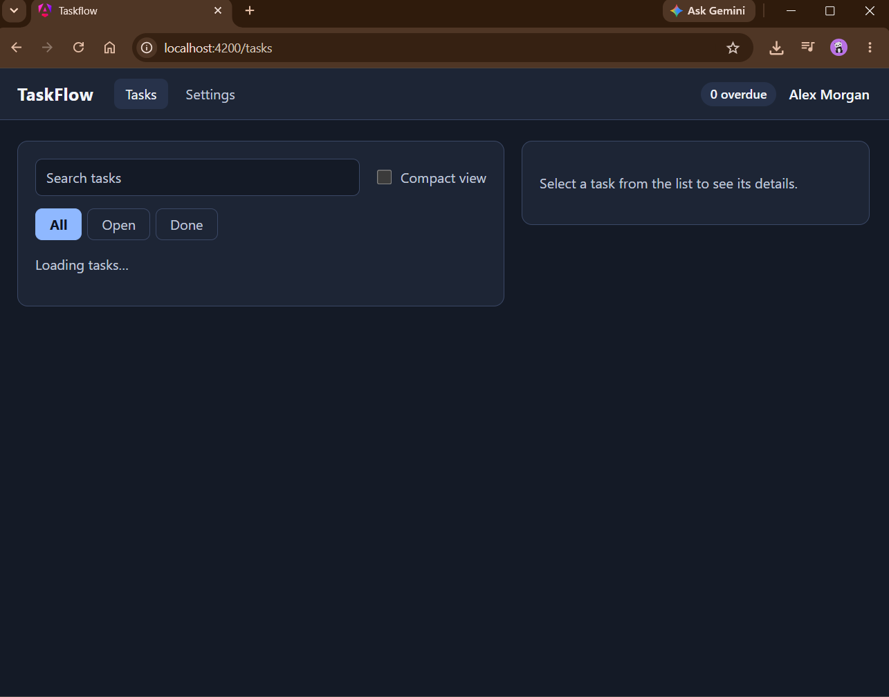
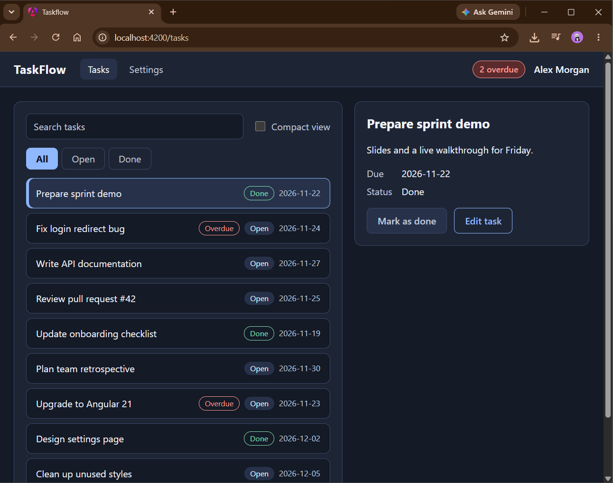

# TaskFlow

A small task manager built with **Angular 21** for the State Management assessment.
The goal is to answer one question for every piece of data: **who owns it?**
State is handled only with signals, signal services, the URL and reactive forms. There is no NgRx and no RxJS Subjects.

---

## A. How to run the app

```bash
npm install
ng serve          # or: npm start
```

Open http://localhost:4200 (Node 20.19 or newer is required).

---

## How I built it

### 1. Planning the state first (before writing code)

Before coding I listed every piece of data and asked the four questions from the session:

1. Does anyone besides this component need it? (Level 1 component, Level 2 parent, Level 3 service)
2. Should it survive a refresh or be shareable as a link? (URL)
3. Is it a copy of backend data? (Server state: loading and caching)
4. Can it be calculated from other state? (`computed()`, never stored)

The answers are in the state table in section B. I wrote the code only after the plan was done.

### 2. Project setup

- Created the project with `ng new taskflow` (Angular 21, standalone components, routing, CSS).
- Folder layout: `core/` (services and model), `layout/` (top bar), `tasks/` (list, details, edit, parent page), `settings/`.
- Enabled `withComponentInputBinding()` in `app.config.ts` so route params and query params arrive as component `input()`s.

### 3. Feature by feature

| # | Requirement | How I implemented it |
|---|-------------|----------------------|
| 0 | Mock `TaskService` with ~10 tasks and a delay | `core/task.service.ts` holds 10 seed tasks. `fetch()` waits 800 ms with `setTimeout` and then sets the tasks, as if they came from an API. `load()` returns the same promise on later calls, so the list is fetched once (cache). Due dates are generated relative to today, so some tasks are always overdue. |
| 1 | Top bar on every page, with user name and "X overdue" | `layout/top-bar.ts` sits in the root `App` template above `<router-outlet>`, so it shows on every route. It reads `TaskService.overdueCount()` and `UserService.name()` directly. `App` calls `load()` on start so the count is correct even on the Settings page. |
| 2 | Loading message | `TaskService` exposes a read-only `loading` signal. `TaskList` shows "Loading tasks…" while it is true. |
| 3 | Search that survives a refresh | The search text is stored in the URL as `?q=`. `TasksPage` receives it as a route input. The list shows the value and emits `qChange`. The parent updates the URL with `router.navigate` (`queryParamsHandling: 'merge'`, `replaceUrl: true`). Because the URL owns it, a refresh brings it back. |
| 4 | Status tabs: All, Open, Done | Same pattern as search, using `?status=open` or `?status=done`. Invalid values fall back to `all`. |
| 5 | Compact-view toggle | A `compact` signal inside `TaskList` (Level 1). Only the list needs it, so it does not go anywhere higher. It adds a `compact` CSS class that makes rows smaller. |
| 6 | Click a task to highlight it and show details | `TasksPage` owns `selectedId` (a signal) because the list and the details panel are siblings (Level 2). It passes `selectedId` to the list with `input()` and receives clicks with `output()`. `selected` is a `computed()` that finds the task in the service, so the panel always shows fresh data. |
| 7 | "Mark as done" updates the top bar immediately | The button calls `TaskService.markDone(id)`, which updates the private signal. `overdueCount` is a `computed()` from the same signal, so the top bar recalculates by itself. Nothing is copied or synced. |
| 8 | Edit form with unsaved-changes warning | `edit-task.ts` uses a reactive `FormGroup` (title, due date, status) with validators. A functional `canDeactivate` guard checks `form.dirty` and asks `confirm()` before leaving. After a successful save the form is marked pristine, so there is no warning. The task id comes from the URL (`:id`). |
| 9 | Settings shows the same user name | `settings-page.ts` reads `UserService.name()`, the same signal the top bar reads. There is one owner and two readers. |

### 4. How I followed the rules

| Rule | How |
|------|-----|
| Use signals, no NgRx, no Subjects | Only `signal`, `computed`, `input` and `output` are used. No `Subject` or `BehaviorSubject` and no NgRx anywhere. |
| Private writable signals, exposed with `asReadonly()` | `TaskService` has private `_tasks` and `_loading`, and `UserService` has a private `_name`. Public versions are `.asReadonly()`. |
| Only service methods change state | The only writers are `markDone()` and `update()` (and the internal `fetch()`). Components never call `.set()` on service state. |
| Derived values use `computed()` | `overdueCount` (service), `visible` (list), `selected` (parent page), `task` (edit page). |
| No `effect()` that copies one signal to another | There is no `effect()` in the project. |
| Reactive forms, no extra form signals | The edit form uses `FormGroup`. Dirty and valid state are read from the form itself. |

### 5. Design

Dark navy theme with light text (high contrast) and a soft blue accent. Overdue items use a coral outline and done items use a green outline, so the state is not shown by colour alone. Keyboard focus is clearly visible and the layout collapses to one column on small screens.

### 6. How I used AI

I used an AI assistant to help plan and review the work. I described the features and first asked for a state plan (kind, owner, level) before any code. I then checked the result against the review checklist from the session (no duplicated data, no public writable signals, no stored values that should be `computed()`, no `effect()` copying signals, no NgRx or Subjects). I also read through the code and ran the app to confirm every feature works.

---

## Screenshots

**Tasks page while loading**


**Task list with an overdue count in the top bar**


**Search and status tab stored in the URL (`?q=...&status=open`)**


**Selected task highlighted with the details panel**


**After "Mark as done": the overdue count in the top bar went down**


**Compact view**


**Edit task page with the unsaved-changes warning**


**Settings page showing the same user name as the top bar**


---

## B. State table

| # | Data | Kind | Where it lives | Why |
|---|------|------|----------------|-----|
| 1 | Search text | URL | `?q=` query param, bound into `TasksPage` through a route input | It must survive a refresh, so the URL owns it and the list only reads it. |
| 2 | Selected status tab | URL | `?status=` query param, bound into `TasksPage` | It is a shareable view of the list, so it follows the same rule as search. |
| 3 | Compact view on/off | Local UI | `compact` signal inside `TaskList` (Level 1) | Only the list uses it, so it stays in the component. |
| 4 | Task list from the API | Server | `TaskService` (root), private `_tasks` signal exposed with `asReadonly()` | It is a copy of backend data used by the top bar, list, details and edit page; the service also holds `loading` and caches the first load. |
| 5 | Selected task | Local UI | `selectedId` signal in `TasksPage` (Level 2); the task itself is a `computed()` | The list highlights it and the details panel shows it, so the shared parent owns it and passes it down with `input()` and `output()`. |
| 6 | Edit form has unsaved changes | Form | `form.dirty` on the `FormGroup` in `EditTask`, read by the `canDeactivate` guard | The `FormGroup` already tracks dirty, so no extra signal is kept. |
| 7 | Overdue task count | Derived | `computed()` in `TaskService` | It is calculated from the task list and never stored, so it updates the moment a task changes. |
| 8 | User's name | Shared | `UserService` (root), private signal exposed with `asReadonly()` | The top bar and Settings are distant components that must show the same value. |

---

## C. Problems in the review code

1. **Stored copy of a derived value.** `overdueCount` is a separate `signal(0)` set inside `load()`. It is calculated from `tasks`, so it goes stale when a task changes (for example "Mark as done"). My app uses `overdueCount = computed(...)` in `TaskService`.
2. **Public writable signals.** `tasks` and `overdueCount` can be changed with `.set()` by any component, so a wrong value could come from anywhere. My services keep writable signals private, expose `asReadonly()`, and change state only through methods such as `markDone()` and `update()`.
3. **`effect()` copying one signal into another.** `TopBarComponent` copies `overdueCount` into `countSig`, which creates a second copy of the same data. My top bar reads `TaskService.overdueCount()` directly in the template.
4. **Server state without loading or caching.** `load()` has no loading flag and nothing stops it from fetching again on every call, and it trusts a server-supplied `isOverdue` flag that becomes wrong as time passes. My service has a `loading` signal, loads once, and calculates overdue from the due date and status.

---

## Project structure

```
src/app/
  core/      task.model.ts, task.service.ts, user.service.ts
  layout/    top-bar.ts
  tasks/     tasks-page.ts (parent), task-list.ts, task-details.ts, edit-task.ts
  settings/  settings-page.ts
docs/screenshots/   images used in this README
```
